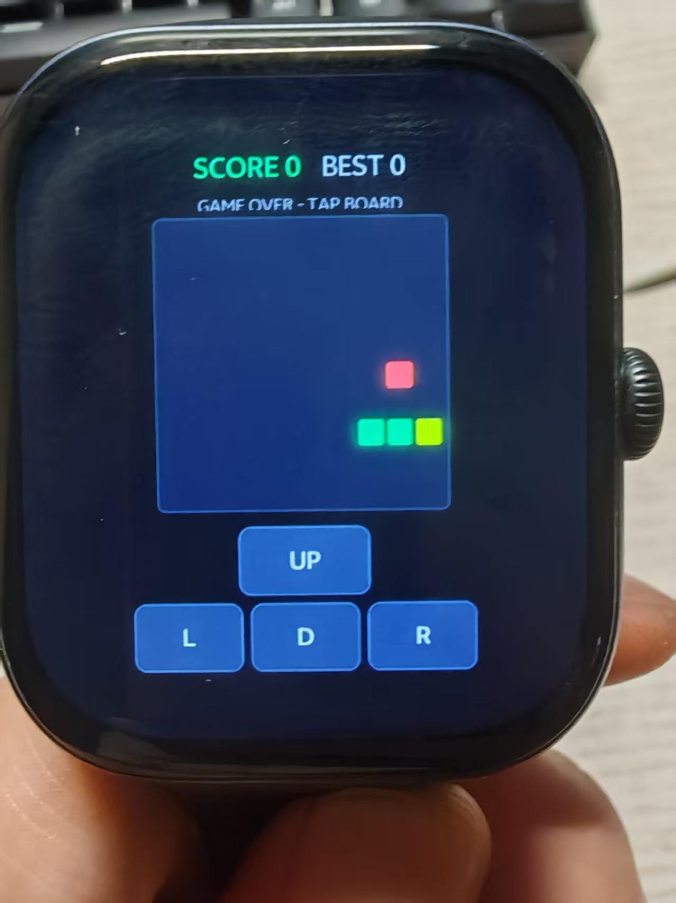
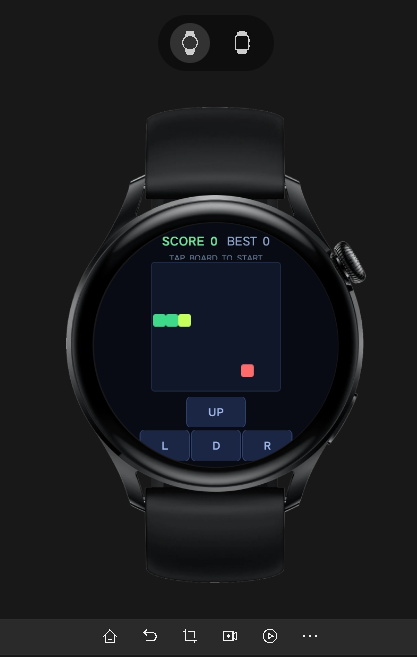

# Snake for vivo BlueOS Watch / 贪吃蛇 · vivo 手表快应用

A classic Snake game ported to vivo BlueOS smartwatches (quick app / 快应用).
Rules are inherited from the open-source
[patorjk/JavaScript-Snake](https://github.com/patorjk/JavaScript-Snake) (MIT),
while rendering, input and the game loop are fully rewritten for a small
round/square watch screen.

经典贪吃蛇，移植到 vivo BlueOS 手表（快应用）。规则内核来自
[patorjk/JavaScript-Snake](https://github.com/patorjk/JavaScript-Snake)（MIT 协议），
渲染、输入与主循环全部为手表小屏重写。

## Screenshots / 截图

| 真机（vivo WATCH GT 2） | Studio 模拟器（圆表 466x466） |
| --- | --- |
|  |  |

## Features / 特性

- **双输入保险**：屏幕下方十字方向键（`onclick` + `ontouchstart` 双绑）+ 棋盘滑动手势，滑动失效也能玩。
- **定时器三层兜底**：BlueOS 页面沙箱不保证暴露定时器，运行时探测 `setTimeout` → `setInterval` → `requestAnimationFrame`，全部缺失时降级 STEP MODE（按一次走一步），不会出现"装上去不动"。
- **墙钟校准推进**：步数按 `Date.now()` 计算，回调迟到只慢一拍不停摆；单次补步封顶 3 步，长时间卡顿不会瞬移。
- **零分配热路径**：棋盘 view 只建一次、原地重绘；`grid`/蛇身用 `Int8Array`/`Uint8Array`；每步最多触碰 4 个格子 —— 针对手表小堆的 GC 压力优化。
- **真机绘制开销优化**：空格子全透明零绘制，实际光栅化量 = 蛇长 + 1；转向"半程即走"降低按钮感知延迟。
- 布局覆盖 BlueOS 预览器全部 6 档机型（圆表 360/399/466/500，方表 390x450、432x514，含 vivo WATCH GT 2）。

## Project structure / 项目结构

```
src/
  manifest.json          # 快应用清单（deviceTypeList: watch-round / watch-square）
  app.ux                 # 应用壳，onError 写入 Studio 日志便于真机排查
  common/
    constants.js         # 棋盘几何与规则常量（继承上游规则值）
    utils.js             # 位置打包 / 转向判定 / 滑动手势映射
  model/
    board.js             # 墙环网格 Int8Array + 食物随机放置（20000 次上限 = 通关）
    snake.js             # 游戏状态机：createGame / turn / step / createRows / paintRows
  pages/Snake/index.ux   # 页面：渲染、双输入、定时器兜底、计分
releases/                # 预编译的 release rpk（可直接安装）
docs/                    # 截图
```

## Build & install / 构建与安装

1. 用 [BlueOS Studio](https://studio.blueos.vivo.com/) 打开本项目根目录（路径需全英文）。
2. 点一次「安装依赖」，然后分别对 `watch-round` / `watch-square` 编译。
3. 真机安装请使用 `dist/<deviceType>/release/` 下的正式包（本仓库 `releases/` 内附一份），安装前卸掉表上同名旧应用；debug 包需要连接开发机才能启动。

## License / 许可证

MIT — 见 [LICENSE](LICENSE)。规则内核移植自
[patorjk/JavaScript-Snake](https://github.com/patorjk/JavaScript-Snake)，感谢原作者
Patrick Gillespie。
